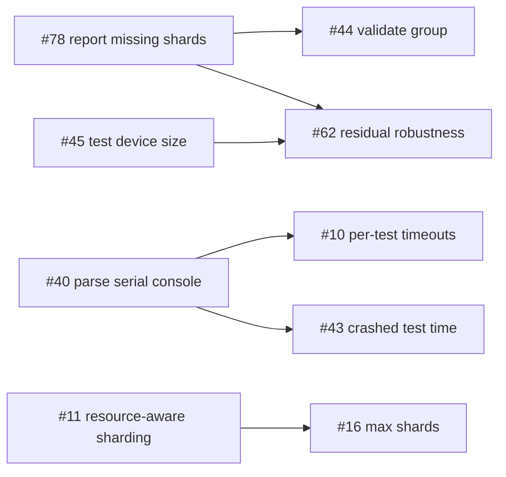

# xfstests-bld: open issue triage (2026-11-26)

All 14 open issues at https://github.com/tytso/xfstests-bld/issues (verified via `gh issue list` after closing #12, #13, and #14 on 2026-11-26), checked against the local tree at `8b053db` (kernel.org `origin/master` `1471b22` plus 62 local commits).

> [!IMPORTANT]
> Everything here was verified by reading code and git history only. Nothing was built, run, or tested, and no GCE resources were touched. "Fix appears valid" means the code does what the issue asked for on inspection, not that it was exercised.

I read "verify whether the bug fix appears valid" as two questions per issue: is the issue still real at HEAD, and is the fix it proposes (or the commit that addressed it) sound.

## Summary

14 issues remain open: 1 High, 7 Medium, and 6 Low (4 partly fixed, 10 unfixed). Issues #12, #13, and #14 were closed on 2026-11-26 (see [Recently closed](#recently-closed-2026-11-26)). None of the 62 local commits closes any of the remaining 14 open issues.

| # | Title (short) | Status at HEAD | Fixing commit(s) | Priority | Rough effort |
|---|---|---|---|---|---|
| 78 | Failed shard missing from email report | Open | none | **High** | S–M |
| 62 | Out-of-space errors, many failures | Partly fixed | `01da22b`, `4082abc`, `b36af8e`, `f62433b`, `2ffb6bc` (mount failure only) | Medium | M |
| 44 | Validate group name | Open | none | Medium | S |
| 45 | Tests skipped for lack of disk space | Open | none | Medium | S |
| 41 | Retry LTM commands on failure | Open | none (`220b863` covers login cookie only) | Medium | S |
| 40 | LTM parses serial console | Open | none (console is captured, not parsed) | Medium | M–L |
| 11 | Sharding with varying CPU/MEM/SSD | Open | none | Medium | M–L |
| 9 | Custom FSTESTSETs | Open | none | Medium | M |
| 16 | Maximum number of shards | Open, plus a latent bug | none | Low | S |
| 43 | ltm-auto-resume improvements | Half fixed | `438ff0e`, `293f89d` (serial console half) | Low | S |
| 42 | Upload aggregate XML separately | Mostly fixed | `88b0870` (upload half) | Low | S |
| 10 | Per-test monitoring timeouts | Partly fixed | `c1a5abd` (one global timeout) | Low | M |
| 39 | Pretty-print LTM commands | Open | none | Low | S |
| 17 | Combine files fetched from GCS at LTM boot | Open | none | Low | S |

Priority weighs three things: whether the problem makes results silently wrong, how often it bites, and how cheap the fix is.

### Suggested order

1. #78, together with the result classification bug described at the end.
2. #44 and #45, which are small and reuse the #78 work.
3. #62 residual items, then #41 and #16 as quick wins.
4. #40, which unlocks #10 and #43.
5. #11, #9, then the low-priority items.

---

## High

### #78: if runtests.sh fails, nothing is reported for that shard

**Status: valid, not fixed.**

The failure is silent at three layers:

- **Appliance.** [runtests.sh](file:///usr/local/google/home/tytso/xfstests-bld/xfstests-agy/test-appliance/files/root/runtests.sh#L160-L445) has seven `continue` paths that abandon a config without writing any xunit record: unknown config (L163), no `TEST_DEV`/`SIZE` (L174), missing log device (L209, L218), missing block device (L276), mkfs failure (L341), missing kernel feature (L351), and `./check -n` failure (L437).
- **Summary.** [gen_results_summary.py](file:///usr/local/google/home/tytso/xfstests-bld/xfstests-agy/test-appliance/files/usr/lib/python3/dist-packages/gen_results_summary.py#L57-L61) only walks `results.xml` files, so a config without one produces no line. With zero files it returns before writing the report at all (L377).
- **LTM.** [shard.finish()](file:///usr/local/google/home/tytso/xfstests-bld/xfstests-agy/test-appliance/files/usr/local/lib/gce-server/ltm/shard.go#L432-L483) marks a shard "finished" with the default result whenever a results tarball exists, whatever is in it. It then deletes the serial log, because a tarball with no xunit errors looks like a clean run. [genResultsSummary()](file:///usr/local/google/home/tytso/xfstests-bld/xfstests-agy/test-appliance/files/usr/local/lib/gce-server/ltm/sharder.go#L736-L780) only appends shard details for non-default results.

**Proposed fix in the issue** (a "shard xy failed" line in the report): sound, but it should be per config. A shard can carry several configs and lose only one.

**Why High:** a missing shard reads as a clean run, which is the worst failure mode for a test harness. It is also the mechanism behind #44 and the "missing shards" symptom in #62. The fix is small.

**Design sketch**

1. Appliance: add a `record_config_error <reason>` helper next to [record_test_error](file:///usr/local/google/home/tytso/xfstests-bld/xfstests-agy/test-appliance/files/root/runtests_utils#L246-L260). It writes a one-testcase `results.xml` using a pseudo-test name such as `setup`, the same way `preempted` and `timeout` are recorded today. Call it on every `continue` path; the earliest ones need `RESULT_BASE` computed sooner.
2. Summary: teach `gen_results_summary` to print "config did not run: reason" for the `setup` pseudo-test and count it as an error, so `report.failed` gets created.
3. LTM: after `aggResults()`, compare each shard's assigned configs (`shard.config` split on commas) with the `TESTCFG` properties found in its `results.xml` files. For anything missing, set the shard result to Error, keep the serial log, and add a "missing results: shard aa, config xfs/4k" line to the report. This also covers old appliance images that lack step 1.
4. Harden [the exit-code check](file:///usr/local/google/home/tytso/xfstests-bld/xfstests-agy/test-appliance/files/root/runtests.sh#L577-L581) so a missing helper or empty output yields exit code 1 instead of a bash syntax error.
5. Tests: a Go unit test using `mock.go` for a shard directory without `results.xml`, and a selftest that passes a bogus group.

---

## Medium

### #62: disk out-of-space errors causing lots of tests to fail

**Status: partly fixed.** The thread describes three separate symptoms.

| Symptom | Status | Evidence |
|---|---|---|
| Shards missing because `TEST_DEV` would not mount on 5.15 | Fixed | mkfs.xfs defaults enabled features 5.15 rejects ("unknown incompatible features (0x20)"). `01da22b`, `4082abc`, `b36af8e` (2024-12-18/19), `f62433b` (2024-12-22) and follow-up `2ffb6bc` add per-LTS mkfs configs. [set_mkfs_config](file:///usr/local/google/home/tytso/xfstests-bld/xfstests-agy/test-appliance/files/root/runtests_utils#L311-L350) picks `lts_5.15` automatically, and [lts_5.15.conf](file:///usr/local/google/home/tytso/xfstests-bld/xfstests-agy/test-appliance/files/root/fs/xfs/mkfs_cfg/lts_5.15.conf#L13-L16) sets `nrext64=0`. |
| ENOSPC, after which every later test fails | Not fixed | Root cause was never established in the thread. Nothing in `runtests.sh` stops or repairs a run once `TEST_DEV` is unusable. |
| 42 MB of serial log spam from `gce-finalize-wait` | Not fixed | [gce-finalize-wait](file:///usr/local/google/home/tytso/xfstests-bld/xfstests-agy/test-appliance/files/usr/local/lib/gce-finalize-wait#L3-L9) is unchanged. When `/usr/bin/sleep` cannot be executed, the loop spins with no delay. |

**Fix validity:** the mkfs-config commits appear valid for the mount failure. That the shards went missing silently is #78, which is still open.

**Why Medium:** the main trigger is fixed and the maintainer proposed dropping 5.15 as a focus. What remains is robustness, but when it happens it wastes a whole shard.

**Design sketch**

1. Log spam: replace `sleep 1` with the bash builtin `read -t 1` on an open descriptor, which needs no exec. Break out after a few consecutive failures. In the LTM, cap what [updateSerialData()](file:///usr/local/google/home/tytso/xfstests-bld/xfstests-agy/test-appliance/files/usr/local/lib/gce-server/ltm/shard.go#L320-L350) keeps, for example by collapsing repeated lines.
2. Cascade breaker: `check` already calls [gce-logger](file:///usr/local/google/home/tytso/xfstests-bld/xfstests-agy/test-appliance/files/usr/local/lib/gce-logger#L15-L40) at each test start. Use that hook to watch for a long streak of consecutive failures or a `TEST_DIR` that is full or shut down. When it trips, stop `check`, kill whatever holds `TEST_DIR`, unmount, re-mkfs `TEST_DEV`, record a pseudo-test error, and resume. The [resume logic](file:///usr/local/google/home/tytso/xfstests-bld/xfstests-agy/test-appliance/files/root/runtests.sh#L468-L496) for crashes already exists. Limit resets per config, then give up with the #78 config error. Stopping `check` from its own logger hook needs a prototype.
3. The thread shows `umount: /xt-vdd: target is busy` before the failed repair, which suggests a leaked process kept the filesystem mounted. This is a hypothesis from the log, not verified.
4. Diagnostics: per-test `df` of `TEST_DIR`, shared with #45.

### #44: validate group name

**Status: valid, not fixed.** [validate_test_name](file:///usr/local/google/home/tytso/xfstests-bld/xfstests-agy/run-fstests/util/parse_cli#L137-L159) exists, but [`-g` and `-x`](file:///usr/local/google/home/tytso/xfstests-bld/xfstests-agy/run-fstests/util/parse_cli#L741-L746) append their argument unchecked. Commit `3359b83` adds validators for email, git refs, timeouts and build options, not groups.

**Proposed fix in the issue** (validate like `validate_test_name`): sound, with one caveat. The client has no authoritative group list, because groups depend on the xfstests version in the image.

**Why Medium:** a typo costs a VM launch and produces an email that does not say what went wrong. The fix is small.

**Design sketch**

1. Server side, authoritative: the LTM VM boots the test appliance image, so it should have the installed xfstests tree under `/root/xfstests`. Check `-g`/`-x` arguments against the per-directory group lists there in `NewShardScheduler` and return an error to the client. `6ac7332` already propagates structured server errors. I did not confirm that the installed tree includes the generated `group.list` files; if it does not, running `./check -n -g <group>` on the LTM is the fallback.
2. Client side, best effort: ship a generated group-name list in `run-fstests/util/` built from xfstests `doc/group-names.txt`. Warn rather than fail if the list might be stale.
3. Appliance side: with #78 done, a failing `./check -n` reports its stderr in the email instead of "Unable to generate test summary report".

### #45: occasionally, tests are skipped due to lack of disk space

**Status: valid, not fixed.** Test devices are still 5 GiB: [gce-setup](file:///usr/local/google/home/tytso/xfstests-bld/xfstests-agy/test-appliance/files/usr/local/lib/gce-setup#L75-L85) passes `5 5 5 20 20 1 1`.

The issue has no proposed fix. The two examples need 4 GB and 3 GB free on a 5 GiB device, so well under 1 GB of leftovers from earlier tests is enough to skip them. That explains "occasionally", but it is an inference; the issue has no `df` data.

**Why Medium:** it is silent coverage loss, though visible as a skip count. The mitigation is cheap.

**Design sketch**

1. Grow `vdb` and `vdd` to 10 GiB on GCE. The default scratch disk is [100 GB](file:///usr/local/google/home/tytso/xfstests-bld/xfstests-agy/test-appliance/files/usr/local/lib/gce-setup-scratch#L22-L27) and the logical volumes use 57 GB of it, so this costs nothing extra. KVM image sizes are set elsewhere and were not checked.
2. Risk: tests that fill `TEST_DIR` will run longer, and some results may shift. Compare a before and after run.
3. Record `df` for `TEST_DIR` per test from `gce-logger`, so the tests that leave debris can be identified.

### #41: retry LTM commands on failure

**Status: valid, not fixed.** [ltm_post_json](file:///usr/local/google/home/tytso/xfstests-bld/xfstests-agy/run-fstests/util/gce-ltm-funcs#L6-L34) makes one attempt. [launch-ltm](file:///usr/local/google/home/tytso/xfstests-bld/xfstests-agy/run-fstests/util/gce-launch-ltm#L204-L221) returns once the VM exists, not once the server is listening. `220b863` only fixed re-login after a bad cookie. The selftests carry [their own wait loop](file:///usr/local/google/home/tytso/xfstests-bld/xfstests-agy/selftests/util/ltm#L6-L50), which shows the need.

**Proposed fix in the issue** (retry and wait inside gce-xfstests): sound, provided a retried submission cannot start a run twice.

**Why Medium:** it breaks any script that launches the LTM and submits straight away. `ltm-batch-cmd` is a workaround. The fix is small.

**Design sketch**

1. Retry in `ltm_post_json`, above `run_gce_curl`, so all three transports are covered. Retry only on transport errors (connection refused, timeout, 502/503), with backoff up to a configurable limit of a few minutes. Never retry on a structured server rejection or a certificate error.
2. Make submission idempotent: generate the test run ID on the client before the first attempt. `901e366` already makes the LTM reject a duplicate active ID.
3. Add `launch-ltm --wait`, which blocks until `/status` answers. The selftests can then drop their loop.

### #40: have LTM parse the serial console of test VMs

**Status: valid, not fixed.** The foundation exists: the LTM already pulls the serial console every 60 seconds in [updateSerialData()](file:///usr/local/google/home/tytso/xfstests-bld/xfstests-agy/test-appliance/files/usr/local/lib/gce-server/ltm/shard.go#L320-L350), but only writes it to a file.

**Proposed approach in the issue:** sound in both parts (detect panics and hangs early; replace metadata as the status channel). One caution: xfstests triggers kernel warnings on purpose, so matching must be narrow and tied to lack of progress.

**Why Medium:** a hang currently costs up to an hour of VM time (`defaultMonitorTimeout`), and this unlocks #10 and #43. It is a larger change.

**Design sketch**

1. Add a line scanner over each new serial chunk, with a small table of patterns: kernel panic, hung task, soft lockup, RCU stall.
2. Policy: a panic already reboots the VM (`c9846b7`), so just record it. For hung-task or lockup messages with no status change for a few minutes, reset early instead of waiting the full timeout.
3. Status channel: have the appliance write one marker line per test start to the console. The LTM parses these for per-test progress, with no metadata rate limit. Keep the metadata update as a fallback, since `gce-xfstests ls` reads it.
4. Go unit tests can feed canned console logs to the scanner.

### #11: LTM sharding with varying CPU/MEM/SSD requirements

**Status: valid, not fixed.** [GetRegionQuota()](file:///usr/local/google/home/tytso/xfstests-bld/xfstests-agy/test-appliance/files/usr/local/lib/gce-server/util/gcp/gcp.go#L148-L175) still hard-codes two CPUs per shard. The [LTM parser](file:///usr/local/google/home/tytso/xfstests-bld/xfstests-agy/test-appliance/files/usr/local/lib/gce-server/util/parser/parser.go#L28-L58) strips `--machtype`, `-n` and `-r` from the request without telling the user. arm64 [disables region sharding](file:///usr/local/google/home/tytso/xfstests-bld/xfstests-agy/test-appliance/files/usr/local/lib/gce-server/ltm/sharder.go#L255-L262) as a stated hack.

**Why Medium:** options the user asked for are dropped silently, and DAX shards (4 CPUs) are under-counted since `b1ca189`. Failures only show near quota limits.

**Design sketch**

1. Give each shard a resource requirement (CPUs, memory, SSD GB). Get it from `gce-xfstests --no-action` for that config, so the machine-type logic stays in one place rather than being copied into Go.
2. Keep raw remaining quota per region instead of pre-dividing by two. Per-family CPU quotas (for example T2A) should be included.
3. Pack with first-fit-decreasing across regions. When configs must be merged into fewer shards, only merge configs with the same requirement.
4. Once accounted for, stop stripping `--machtype`, `-n` and `-r`. Filter zones by machine-type availability, which removes the arm64 hack.

### #9: gce-xfstests to use custom FSTESTSETs

**Status: valid, not fixed.** The test set goes from GCE metadata into the [kexec command line](file:///usr/local/google/home/tytso/xfstests-bld/xfstests-agy/test-appliance/files/usr/local/lib/gce-load-kernel#L141), and the appliance [reads it back from `/proc/cmdline`](file:///usr/local/google/home/tytso/xfstests-bld/xfstests-agy/test-appliance/files/root/kvm-xfstests.boot#L8-L34). The kernel command line is limited to 2048 bytes on x86 and arm64, and it also carries the base64 original command line, which contains the test list a second time.

**Proposed approach in the issue** (pass the set through metadata or a file): sound. Metadata survives kexec and reboot and allows 256 KB per value.

**Why Medium:** it blocks real uses, such as re-running a long list of failed tests. Moderate work across client, appliance and LTM.

**Design sketch**

1. Appliance on GCE: after kexec, read `fstestset`, `fstestexc` and `orig_cmdline` from metadata rather than `/proc/cmdline`, and stop putting them on the kexec command line. Keep `fstestcfg` there, because [L69](file:///usr/local/google/home/tytso/xfstests-bld/xfstests-agy/test-appliance/files/root/kvm-xfstests.boot#L69-L73) uses it as the "already kexec'd" marker.
2. Client: add `--test-list FILE`. For GCE, send it with `--metadata-from-file`. For KVM, pass the file through the existing upload tarball.
3. LTM: carry the list as a new JSON field, write it to a per-run file on the LTM VM, and add `--test-list` to each shard's command. Add the option to the parser's strip list so it is not forwarded twice.

---

## Low

### #16: allow passing LTM a maximum number of shards

**Status: valid, not fixed, and the dormant code is wrong.** `maxShards` is [always 0](file:///usr/local/google/home/tytso/xfstests-bld/xfstests-agy/test-appliance/files/usr/local/lib/gce-server/ltm/sharder.go#L206); no request field or CLI option sets it. If it were set, [L298-L300](file:///usr/local/google/home/tytso/xfstests-bld/xfstests-agy/test-appliance/files/usr/local/lib/gce-server/ltm/sharder.go#L298-L300) uses `MaxInt`, which would raise the shard count above quota instead of capping it. It is also only applied to local sharding.

**Why Low:** nothing can trigger it today. It is a small change and a natural companion to #11.

**Design sketch:** add `--max-shards N` to `parse_cli`, a `max_shards` JSON option, and a positive-integer validator on both sides. Change `MaxInt` to `MinInt`, and apply the cap in region sharding too.

### #43: ltm-auto-resume improvements

**Status: half fixed.**

- "Always save serial console": addressed by `438ff0e` (2023-01-30), then narrowed by `293f89d` (2023-07-21) to keep the log only when the VM rebooted or timed out. The intent is met; the fix appears valid.
- Crashed tests get 0 seconds: not fixed. [add_error_xunit](file:///usr/local/google/home/tytso/xfstests-bld/xfstests-agy/test-appliance/files/usr/local/bin/add_error_xunit#L35-L39) still sets `tc.time = 0`.

**Why Low:** it only skews timing statistics.

**Design sketch:** have `gce-logger` store an epoch timestamp when it appends to `completed`. On resume, compute elapsed time as current boot time minus that timestamp and pass it via a new `--time` option. This includes reboot time, and for a hang it correctly equals the monitor timeout. Skip it for the `preempted` pseudo-test, where the VM may have been stopped for a long time.

### #42: upload XML file with aggregate results separately

**Status: mostly fixed.** `88b0870` (2024-07-21) uploads the merged junit file as [`results.<run>.<kernel>.xml`](file:///usr/local/google/home/tytso/xfstests-bld/xfstests-agy/test-appliance/files/usr/local/lib/gce-server/ltm/sharder.go#L907-L909). Single-VM runs do the same in `gce-shutdown`. The fix appears valid.

The remaining half is converting the processing scripts: [get_stats.py](file:///usr/local/google/home/tytso/xfstests-bld/xfstests-agy/test-appliance/files/usr/lib/python3/dist-packages/get_stats.py#L17-L21) still takes a results directory.

**Why Low:** the expensive part is done; what is left is a convenience.

**Design sketch:** let `get_stats.py` accept either a directory or the merged XML file. Optionally add a `get-results` mode that downloads only the XML. Then close.

### #10: LTM shard monitoring timeouts on a per-test basis

**Status: partly fixed.** `c1a5abd` added `--monitor-timeout`, one value for the whole run, defaulting to one hour. Per-test timeouts do not exist.

**Proposed approach in the issue:** sound in principle, but the 20–30 second example is not reachable today. Status reaches the LTM through metadata limited to one update a minute, polled once a minute.

**Why Low:** the global flag covers most of the need, and #40 is a prerequisite for fine granularity.

**Design sketch:** per-test durations already exist in `check-time.tar.gz` in the bucket. The LTM loads them once per run and uses a clamped multiple of the expected time for the current test, with `--monitor-timeout` as the ceiling. The floor stays at several minutes until #40 lands.

### #39: pretty prints for LTM commands

**Status: valid, not fixed.** [ltm_post_json](file:///usr/local/google/home/tytso/xfstests-bld/xfstests-agy/run-fstests/util/gce-ltm-funcs#L23-L26) pipes the response through `jq '.'`, which is indented JSON, not a summary.

**Proposed fix in the issue** (pretty by default, `--json` to opt out): sound, but it would break existing JSON consumers such as [selftests/util/ltm](file:///usr/local/google/home/tytso/xfstests-bld/xfstests-agy/selftests/util/ltm#L61-L83).

**Why Low:** cosmetic.

**Design sketch:** render a table with `jq` (one row per sharder, then per shard: config, zone, VM status, time since update, result). Use it when stdout is a terminal, and keep JSON when piped. Add `--json` and `--pretty` as overrides.

### #17: speed up LTM launch by combining the files read from GCS

**Status: valid, not fixed.** [gce-fetch-gs-files](file:///usr/local/google/home/tytso/xfstests-bld/xfstests-agy/test-appliance/files/usr/local/lib/gce-fetch-gs-files#L6-L36) now uses `gcloud storage` instead of `gsutil`, but still invokes it 4–5 times on an LTM or KCS VM (1–2 calls in `gce_resolve_and_fetch_config` for shared-bucket per-project slot resolution, plus separate fetches for `server.pem`, `cert.pem`, and `ltm-pass`). The 20-second figure is from 2018 and was not re-measured.

**Proposed fix in the issue** (one tar file): works, but adds a second copy of secrets that must be kept in sync whenever the certificate or config changes.

**Why Low:** it saves seconds on an infrequent operation.

**Design sketch:** measure first. Then, once `gce_resolve_and_fetch_config` resolves `$GS_BUCKET_PREFIX`, fetch the remaining three objects (`server.pem`, `cert.pem`, `ltm-pass`) with a single `gcloud storage cp` into a private directory under `/run` and install each file with its current mode. That removes two subprocess startups with no change to the bucket layout.

---

## Recently closed (2026-11-26)

Closed via [close-resolved-issues.sh](file:///usr/local/google/home/tytso/.gemini/jetski/brain/1dea5898-6e8b-4c77-8833-da2e0768016f/scratch/close-resolved-issues.sh) and verified absent from `gh issue list --state open`:

- **#12** (*LTM should allow launching child VMs with DAX config*) — closed as `completed`. Resolved by `b1ca189bf436` (2022-01-25, "ltm: stop ltm ignoring dax configs"); general resource-aware sharding remains tracked in #11.
- **#13** (*LTM to use/handle preemptible instances*) — closed as `completed`. Resolved by `5a2b84764371`, `7811e74f5315`, `9c911e52edb4`, `9de08c65dec9`, and `df961e542084` (July 2023) for Spot/preemptible VM restarts, test resume, and `preempted` reporting.
- **#14** (*LTM support running on f1-micro instance*) — closed as `not planned` (obsolete). The Python per-process LTM was replaced by the Go `gce-server` LTM (`4b824d9e1d37`, `cbc1246150d0`, `b5c01e52220e`, `ab956b5236ae`), and the default LTM machine type was moved to [e2-small](file:///usr/local/google/home/tytso/xfstests-bld/xfstests-agy/run-fstests/util/gce-launch-ltm#L107-L116) in `b55b2872b416` (configurable via `GCE_LTM_MACHTYPE` since `8c24b71dc3be`).

---

## Adjacent finding, not an open issue

While reading the #78 code path I found a result classification bug in the LTM. [genResultsSummary()](file:///usr/local/google/home/tytso/xfstests-bld/xfstests-agy/test-appliance/files/usr/local/lib/gce-server/ltm/sharder.go#L757-L770) decides whether a run failed with `strings.Contains(report, "0 failures")`.

- A report line with "10 failures", "20 failures" or "100 failures" contains that substring, so such a run is classified as Pass.
- If the report file is missing, which is the #78 case, the run is also classified as Pass unless a shard reported an error.

This result is what gets sent to KCS for [bisect steps](file:///usr/local/google/home/tytso/xfstests-bld/xfstests-agy/test-appliance/files/usr/local/lib/gce-server/ltm/sharder.go#L838-L860) and recorded for watchers, so a bisect step with exactly 10 failures would be marked good. Email routing is not affected, because it uses the separate `report.failed` marker. The fix belongs with #78: classify from the merged xunit counts or the `report.failed` marker, and treat a missing report as Error.
